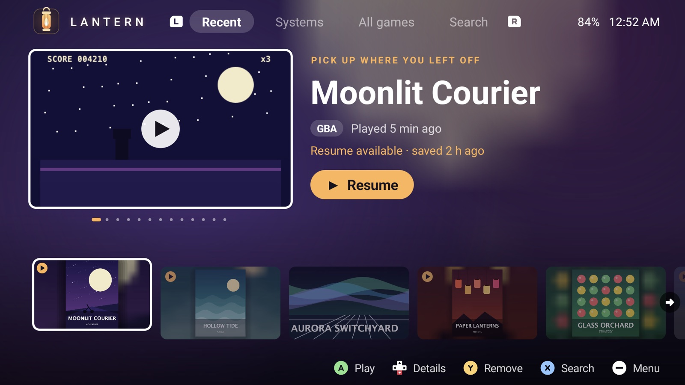
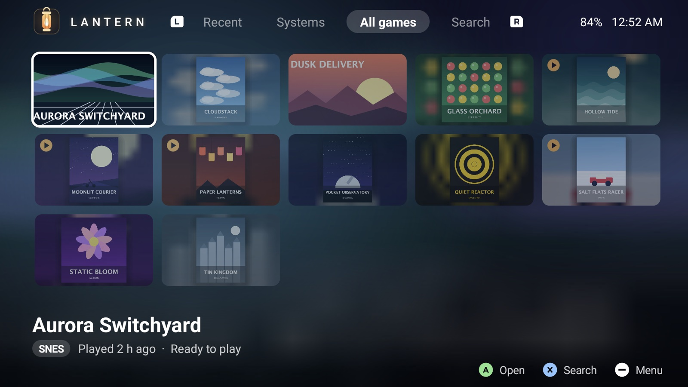
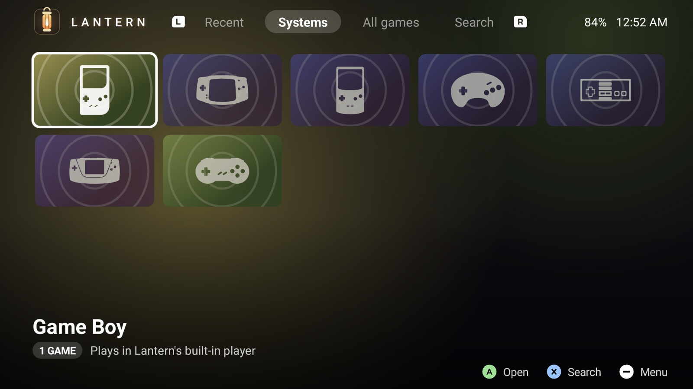
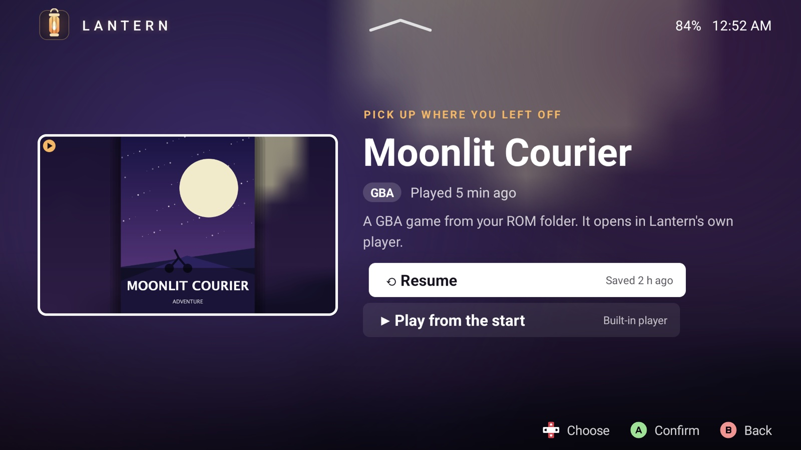
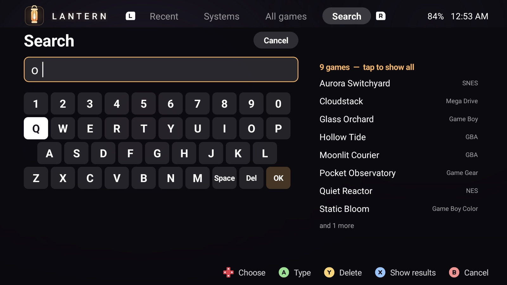
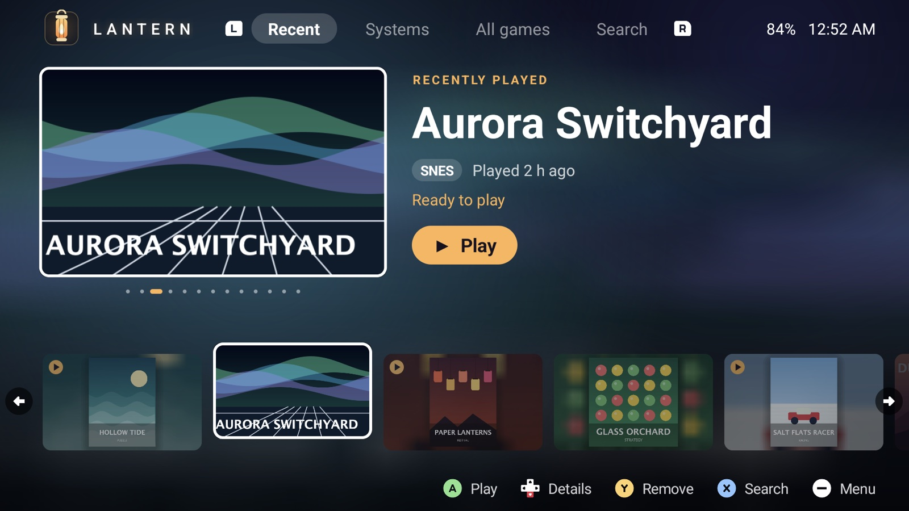
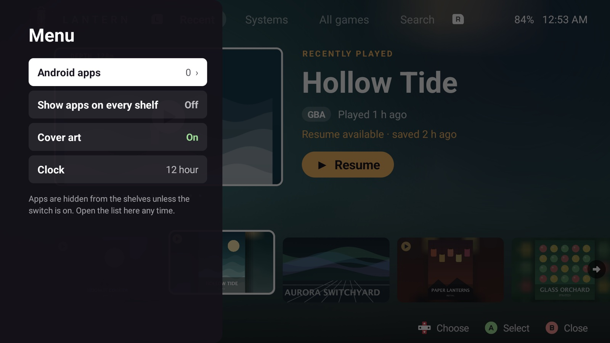

<p align="center">
  
</p>

<h1 align="center">Lantern</h1>

<p align="center">
  A console-style home screen for Android handhelds, with a built-in player for retro games.<br>
  Gamepad first. Open source (MIT). Made for the Retroid Pocket 6.
</p>

<p align="center">
  
</p>

> The games, covers and screenshots in this README are made up for the project (original artwork, invented titles).
> Lantern ships with **no games, no BIOS files and no emulator cores**: see [Set it up](#set-it-up) and
> [Legal](#legal).

## What it is

Lantern replaces the stock launcher on a handheld. Every game is a tile, whether it is a retro ROM, an Android game or
an app. Press A and you are playing. There are no menus to dig through, and everything works from the gamepad.

- **Recent**: one big tile for the game you played last, showing a screenshot of where you left off, and a row of
  your other recent games. Press A to jump straight back in, Down for the game's page, Y to remove a game from the list.
- **Systems** and **All games**: uniform tiles in a grid, with the focused game's name under it.
- **Search**: an on-screen keyboard with live results.
- **A built-in player** for libretro cores: save states, a resume point every time you leave, cheats, button remapping
  per game or per console, fast-forward, integer scaling and scanlines.
- **Cover art** from your own pictures, or fetched from the public libretro thumbnail server if you turn that on
  (it is off by default). Games without art get a generated tile.
- **Colour themes**: press Select, then pick *Colours* (Lantern, Ember, Ocean or Night).
- Smooth, direction-aware motion: the screen moves the way you press.

<p align="center">
  
  
</p>
<p align="center">
  
  
</p>
<p align="center">
  
  
</p>

## Status

Early (version 0.1). It is built and tested on a **Retroid Pocket 6** (Android 13, 1920x1080, landscape). It should
run on other 64-bit ARM Android devices (Android 8 or newer) but has not been tried on them, and the layout assumes a
16:9 landscape screen. It is sideloaded: there is an APK on the [Releases](https://github.com/itsjaspermilan/lantern/releases)
page, but no Play Store listing and no auto-update. Emulation covers Game Boy, GBA, NES, SNES, Mega Drive and friends, Nintendo 64 (Mupen64Plus-Next), Nintendo DS (melonDS) and GameCube (Dolphin); there are
no PlayStation, DS or PSP cores yet. See [TODO.md](TODO.md).

## Set it up

Setup has four parts: install the APK, give Lantern access to your games, add the emulators you want (in the app), and
(optionally) make it your home screen. You do not need to build anything: to build it yourself instead, see
[Build it yourself](#build-it-yourself).

### 1. Install the APK

Download **`lantern-0.1.0.apk`** from the [latest release](https://github.com/itsjaspermilan/lantern/releases/latest).
It contains no emulators and no games. Then install it one of two ways.

**With ADB from a computer (recommended).** ADB is Google's small command-line tool for talking to an Android
device over USB.

1. Get ADB: on macOS `brew install android-platform-tools`; on Windows `winget install Google.PlatformTools`; on
   Linux your package manager's `adb` or `android-tools` package. Or download
   [SDK Platform-Tools](https://developer.android.com/tools/releases/platform-tools) from Google and unzip it.
2. On the handheld, turn on **Developer options** (*Settings > About*, tap *Build number* seven times), then
   **USB debugging** in *Settings > System > Developer options*.
3. Connect the handheld with a USB cable. Run `adb devices`, and on the handheld allow the computer when it asks. The
   device should be listed as `device` (not `unauthorized`).
4. Install, from the folder you downloaded the APK to:

```sh
adb install lantern-0.1.0.apk
```

To update later, download the new APK and run `adb install -r lantern-<version>.apk` (`-r` keeps your settings).
If it fails with `INSTALL_FAILED_UPDATE_INCOMPATIBLE`, a build signed with a different key (such as your own debug
build) is installed: remove it first with `adb uninstall app.lantern` (that also clears Lantern's settings and
downloaded emulators; your games and saves in `/sdcard/Lantern/` stay).

**On the handheld alone.** Open the release page in the handheld's browser, download the APK and open it; Android asks
you to allow installs from your browser or file manager. On devices where Google's
[developer verification](https://android-developers.googleblog.com/2026/03/android-developer-verification-rolling-out-to-all-developers.html)
applies, Android may warn that the developer is not verified or require its "advanced flow" (a setting in Developer
options and a one-day wait). Installing with ADB is not affected.

### 2. Give it access to your games

Lantern reads game folders in shared storage, which Android treats as "all files access". The first time you open it with
no games, press **Select** for the menu; if access is missing it shows an **Allow file access** row that opens the right
settings page (or go to *Settings > Apps > Lantern > Permissions > All files access*).

Then put your games here, one folder per system. Lantern does not create the `roms` folders: make them yourself.

```
/sdcard/Lantern/roms/<system>/<your games>
```

| Folder | System | File types | Core Lantern uses |
|---|---|---|---|
| `nes` | NES / Famicom | `.nes` `.unf` `.unif` | FCEUmm |
| `snes` | Super Nintendo | `.sfc` `.smc` | Snes9x |
| `gb` | Game Boy | `.gb` `.gbc` | Gambatte |
| `gbc` | Game Boy Color | `.gbc` `.gb` | Gambatte |
| `gba` | Game Boy Advance | `.gba` | mGBA |
| `md` | Mega Drive / Genesis | `.md` `.gen` `.smd` | Genesis Plus GX |
| `mastersystem` | Master System | `.sms` | Genesis Plus GX |
| `gamegear` | Game Gear | `.gg` `.sms` | Genesis Plus GX |
| `n64` | Nintendo 64 | `.z64` `.n64` `.v64` | Mupen64Plus-Next |
| `nds` | Nintendo DS | `.nds` | melonDS |
| `gc` | Nintendo GameCube | `.iso` `.gcm` `.ciso` `.gcz` `.rvz` | Dolphin |
| `psx`, `psp`, `saturn`, `dc`, `ps2` | listed, but **no core yet** | various | none |

Copy the folders over USB, with `adb push roms /sdcard/Lantern/` (from a local folder named `roms`), or with any file manager. Installed Android games
and apps appear on their own (apps are hidden from the shelves until you switch them on in the menu).

Other folders under `/sdcard/Lantern/` (all optional):

| Folder | What goes in it |
|---|---|
| `bios/` | BIOS files a core needs. Yours to supply: Lantern includes none, and the cores listed above need none. |
| `saves/<system>/` | Created by Lantern: in-game saves, save states, the resume point and its screenshot, and the emulator settings you chose (`<core>.options`, from *Emulator* in the game menu). |
| `art/<system>/<game>.png` (or `.jpg`) | Your own cover for a game, named like its ROM without the extension. |
| `art/androidgames/<package>.png` | Cover for an Android game, named after its package (or its title). |
| `cheats/<system>/<game>.cht` | Cheats in RetroArch's `.cht` format, named like the ROM. |

### 3. Add emulators

Lantern plays games with **libretro cores**: separate emulator libraries. None is included, because cores have their
own licences (some are GPL, some are non-commercial only). You add the ones you want **in the app**:

- Press **Select**, choose **Emulators**, pick one and press **A**. It shows what each plays and its licence, then
  downloads it (about 0.4 to 1.1 MB each) from libretro's public build server, `buildbot.libretro.com`, into Lantern's
  own storage. Press A twice on an installed one to remove it.
- Or just press **Play** on a game: if its system has no emulator yet, the list opens on the one it needs.

The handheld needs an internet connection for this step only.

### 4. Make it your home screen (optional)

Press the Home button. Android asks which home app to use; choose Lantern and *Always*. Or:

```sh
adb shell cmd package set-home-activity app.lantern/.HomeActivity
```

Or *Settings > Apps > Default apps > Home app*. To go back to the stock launcher, choose it the same way.

### Cover art

Press **Select** and turn **Cover art** on. Lantern then looks up box art for games that have none, from the public
[libretro thumbnails](https://github.com/libretro-thumbnails) server, once, and keeps what it finds in its own
storage. Apart from downloading the emulators you choose, this is the only thing Lantern uses the network for, and it is off
until you turn it on. Names are matched to the
ROM's file name (the usual "No-Intro" style, e.g. `Game Name (USA).gba`). To use a different mirror, put its address on
the first line of `/sdcard/Lantern/art-source.txt`.

## Using it

| Button | What it does |
|---|---|
| **D-pad** | Move. On Recent: Left and Right choose a game, Down opens its page, A plays at once. |
| **A** | Play / open. |
| **B** | Back (out of a page, a system or a search). |
| **X** | Search. |
| **Y** | On Recent: take the big game off the list (its saves are kept). |
| **L1 / R1** | Previous / next tab. |
| **L2 / R2** | Jump to the previous / next letter in a grid. |
| **Select** | The menu: Android apps, emulators, switches, clock. |

Inside a game, the **Home/Mode** button, **Back**, or **Select + Start** open the game's menu: resume, save and load
states (several slots), cheats, controls (remap any button, for this game or for the whole console), options (scaling,
aspect, scanlines), and quit. Holding **R2** fast-forwards. Leaving a game any way (Home, the menu, the screen turning off) saves
a resume point, so **Resume** puts you back exactly where you were.

## Project layout

| Path | What is there |
|---|---|
| `app/src/main/java/app/lantern/` | The launcher and player UI, in plain Java (no Gradle, no libraries). |
| `native/player/player.c` | The native player host: loads a core, runs it on its own thread, video, audio, input, saves. |
| `native/testcore/` | A tiny libretro core that needs no game, used to test the player. |
| `native/third_party/libretro/` | The libretro API header (MIT). |
| `tests/`, `test.sh` | Checks of the plain logic, run on the computer. |
| `scripts/fetch-cores.sh` | Optional helper that downloads emulator cores to package into your own build. |
| `docs/` | `development-notes.md` (a log of how it was built and measured), images. |
| `AUDIT.md` | A code quality and performance audit, with measurements. |
| `licenses/`, `THIRD_PARTY_NOTICES.md` | Licences of everything that is not Lantern's own. |

## Troubleshooting

- **`adb devices` shows nothing or `unauthorized`.** Try another cable (some only charge), turn USB debugging off and on,
  and allow the computer on the handheld's screen.
- **No games show up.** Check *All files access* is allowed, the folder names match the table (lower case), and the files
  have the right extensions.
- **"Press A to add the emulator for ..."** The system's emulator is not added yet: see step 3.
- **An emulator download fails.** Check the handheld is online; libretro's build server is sometimes slow or down, so
  try again later. Systems marked "No emulator ... yet" (PlayStation and others) have none in Lantern at all.
- **A game does not start.** Some games need a BIOS file in `/sdcard/Lantern/bios/`; the cores above do not. Check
  the file is not damaged.
- **No cover art.** Turn Cover art on in the menu, make sure the file names are in the usual "Game Name (Region)" form, or
  add your own picture to `art/<system>/`.
- **The build fails on `android-36` or the NDK.** Check `ANDROID_HOME` and `ANDROID_NDK_HOME` point where you think.

## Build it yourself

You need a computer (macOS or Linux; the build is a shell script, not Gradle) and the handheld connected with USB
debugging on (see [step 1](#1-install-the-apk)).

| Needed | Notes |
|---|---|
| **JDK 17** | `java`, `javac` and `keytool` on your `PATH` (or set `JAVA_HOME`). |
| **Android SDK** | Set `ANDROID_HOME` (default `~/Library/Android/sdk`). Install **platform `android-36`**, the latest **build-tools** and **platform-tools** (for `adb`). |
| **Android NDK** | Any recent one (tested with r29). Set `ANDROID_NDK_HOME`, or it uses the newest in `$ANDROID_HOME/ndk`. It builds the native player. |
| `zip`, `unzip`, `curl` | Usually already installed. |

Install the SDK pieces with Android Studio's SDK Manager, or with the command line tools:

```sh
sdkmanager "platforms;android-36" "build-tools;36.0.0" "platform-tools" "ndk;29.0.14206865"   # versions as tested; newer ones work too
```

Then build and install:

```sh
git clone https://github.com/itsjaspermilan/lantern.git
cd lantern
./build.sh              # produces build/lantern-debug.apk
./build.sh install      # builds, then runs: adb install -r build/lantern-debug.apk
./test.sh               # the plain-logic checks, no device needed
```

The build signs the APK with a throwaway debug key that it creates in `build/` (never committed). A debug build and the
release APK are signed with different keys, so one cannot be installed over the other: `adb uninstall app.lantern`
first. Then carry on with [step 2](#2-give-it-access-to-your-games).

**Packaging emulators into your own build.** Instead of downloading emulators in the app, you can put
`<name>_libretro_android.so` files (64-bit ARM) in `native/cores/`, or let `scripts/fetch-cores.sh --list` /
`scripts/fetch-cores.sh mgba gambatte` download them there (it asks first), then `./build.sh install`. A packaged core
wins over a downloaded one. Read [native/CORES.md](native/CORES.md) first, and **keep an APK that contains cores to
yourself**: the licences of some cores do not allow passing it on.

## Making a release

For the author (or anyone publishing their own build). A release is signed with a key that only its author has, so
that updates install over earlier versions. Make the key once, outside the repository, and keep a backup of it and its
password: without them, later versions cannot update an installed one.

```sh
keytool -genkeypair -keystore ~/lantern-release.jks -storetype PKCS12 -alias lantern -keyalg RSA -keysize 4096 -validity 10000 -dname "CN=Your Name"
```

Then raise `VERSION_NAME` and `VERSION_CODE` at the top of `build.sh`, and:

```sh
./build.sh release      # build/lantern-<version>.apk: no emulator cores, signed with ~/lantern-release.jks (asks for its password)
```

`LANTERN_KEYSTORE` points it at a key somewhere else. The release build leaves out anything in `native/cores/` and stops
if a core ends up in the APK anyway. A release APK cannot be installed over a debug build (different keys): uninstall
the debug build first.

## Contributing

Issues and pull requests are welcome. Please run `./test.sh` and check your change on a device if you can: much of the
interface is motion and layout, which tests do not cover. Keep new dependencies and assets compatible with the MIT licence
and record them in `THIRD_PARTY_NOTICES.md`.

## Legal

Lantern's own code is released under the **MIT licence** (see [LICENSE](LICENSE)). The third-party material in the
repository (the libretro header, console icons from libretro's retroarch-assets under CC BY 4.0, Kenney's button
prompts under CC0, and Google's Material "android" icon under Apache-2.0) is listed with its licence in
[THIRD_PARTY_NOTICES.md](THIRD_PARTY_NOTICES.md).

- **Games and BIOS files are yours to supply.** Lantern includes none. Only use games you own or have the right to use.
- **Emulator cores are not included** and have their own licences (GPL, MPL, and some non-commercial only). The app
  downloads them, when you ask, straight from libretro to your device. See [native/CORES.md](native/CORES.md). An APK
  that contains cores should not be redistributed.
- **Cover art** fetched from the thumbnail server belongs to its publishers and artists. Lantern only displays it on your
  device.
- Console and platform names are trademarks of their owners. Lantern is independent and not affiliated with or endorsed
  by any of them.

This is not legal advice.
